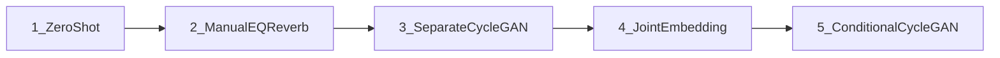

# Domain adaptation narrative

How we move from “play OOD audio into a BRAVE trained on domain Y” toward controllable tap → target timbre transfer.

Per-domain Foundation Y / CycleGAN checklist: [`foundation_training_status.md`](foundation_training_status.md).

## 1. Zero-shot BRAVE

Train an unconditional BRAVE on the **target** domain only (e.g. birdsong, water). At inference, feed **source** audio (e.g. body tap) straight into that model: encode → decode with no extra adapter.

- Strength: simplest baseline; same export path as any BRAVE run.
- Failure mode: OOD inputs land off the Y manifold — wrong timbre, ringing, silence/gain quirks.

Docs: [`CLAUDE.md`](../CLAUDE.md) (train/export), [`configs/brave.gin`](../configs/brave.gin).

## 2. Manual domain adaptation

Keep the frozen Y BRAVE. Before encode, hand-tune **EQ / reverb** (and related DSP) so the tap signal better resembles in-domain Y acoustics.

- Strength: interpretable; fast to try on a Max/host path; motivates which cues matter (spectrum, room).
- Failure mode: brittle across players, mics, and gain; no learned content/timbre tradeoff.

## 3. Learned adaptation — CycleGAN Approach 2 (separate)

Train **two** plain BRAVE codecs (domain X and domain Y). Learn bidirectional warps that transfer **between** their latent spaces:

| Intent | Path |
|--------|------|
| X → Y | `Enc_X(x) → W_xy → Dec_Y` |
| Y → X | `Enc_Y(y) → W_yx → Dec_X` |

Freeze both backbones; cycle + GAN; warps are **cross-space** with random init.

- Docs: [`docs/cyclegan/`](cyclegan/README.md), [`configs/brave_cyclegan_separate.gin`](../configs/brave_cyclegan_separate.gin)
- Strength: no hand DSP; bidirectional transfer; reuses frozen AEs.
- Failure mode: \(Z_X \not\approx Z_Y\) as coordinates — harder warps, foreign-manifold AE-aware cycle, dual-ckpt export graph.

## 4. Joint embedding — CycleGAN Approach 3

Train **one** BRAVE on both domains (stratified dual-LMDB: `--db_path_x` + `--db_path_y`, 50/50 batches) so they share a latent \(Z\). Then CycleGAN warps are **within-space** remaps on that shared codec:

| Intent | Path |
|--------|------|
| X → Y | `Enc(x) → W_xy → Dec` |
| Y → X | `Enc(y) → W_yx → Dec` |

Config: [`configs/brave_cyclegan_joint.gin`](../configs/brave_cyclegan_joint.gin). Identity residual init; identity loss is meaningful. Export loads one backbone ([`scratchpaper/joint_embedding_cyclegan.md`](../scratchpaper/joint_embedding_cyclegan.md)).

- Strength: simpler geometry; apples-to-apples vs Approach 2 on the same domains.
- Failure mode: joint AE may still entangle domains unevenly; AE-aware cycle is no longer a *foreign* codec critic — domain signal shifts to D / identity.

Balanced joint AE train: [`scripts/submit_joint_train.sh`](../scripts/submit_joint_train.sh) (`DB_PATH_X` + `DB_PATH_Y`).

---

## 5. Conditional CycleGAN (Fader controls)

Full conditional matrix (foundation × CycleGAN geometry):

| Foundation | CycleGAN |
|------------|----------|
| **Separate:** Fader on \(X\) and/or \(Y\) (\(c\in x\), \(c\in y\)) | Approach 2 — [`brave_cyclegan_conditional.gin`](../configs/brave_cyclegan_conditional.gin) |
| **Joint:** one Fader on \(X\cup Y\) with schema \(c\in x\cup y\) + availability masks | Approach 3 — [`brave_cyclegan_conditional_joint.gin`](../configs/brave_cyclegan_conditional_joint.gin) |

CycleGAN math is the same in both rows (A/B/C, bookkept return \(c\), \(L_\mathrm{inv}\), audio AC-GAN). Joint only adds `shared_backbone`, identity warp init, and native-vs-schema \(c\) bookkeeping. Empty attribute lists recover unconditional CycleGAN.

- Method: [`cyclegan/conditional.md`](cyclegan/conditional.md) (§10 matrix + joint foundation)
- Design checklist: [`cyclegan/conditional_cyclegan_plan.md`](cyclegan/conditional_cyclegan_plan.md)
- Joint Fader train: [`configs/brave_fader_joint_tap_water.gin`](../configs/brave_fader_joint_tap_water.gin), [`scripts/submit_joint_fader_train.sh`](../scripts/submit_joint_fader_train.sh)

---

**Reading order:** zero-shot Y BRAVE → manual EQ/reverb → separate CycleGAN → joint AE + joint CycleGAN → conditional separate and/or conditional joint when domains have Fader attributes.
